🌐 **简体中文** · [English](README.en.md) · [日本語](README.ja.md) · [한국어](README.ko.md) · [Français](README.fr.md) · [Español](README.es.md) · [Deutsch](README.de.md) · [العربية](README.ar.md) · [Tiếng Việt](README.vi.md) · [Português](README.pt.md) · [Italiano](README.it.md)

▶ **在线试玩（手机 / 电脑浏览器都能玩）**: https://yanbowa.ng/Avoiding-Electric-Vehicles/

# 躲避电鸡 Avoiding Electric Vehicles

> 广州、深圳很多路段没有非机动车道。你走路、骑车或开车出门，电动车（电鸡）会从四面八方冒出来：逆行、超车、钻缝、横冲、急刹……在一分钟里活下来吧。

Godot 4（GL Compatibility）· Windows / macOS · 1280×720 · 12 关 · 步行 / 骑车 / 开车 + 无敌模式

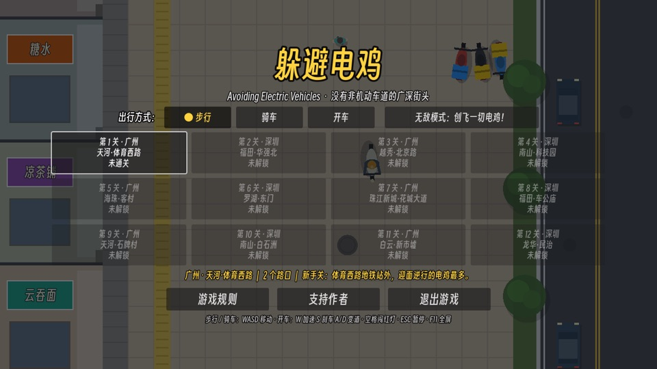

## 怎么玩

| 操作 | 步行 / 骑车 | 开车 |
|---|---|---|
| 移动 | WASD / 方向键 / 手柄摇杆 | W 加速 · S 刹车 · A / D 变道 |
| 闯红灯 | 路缘前按住 ↑ 半秒，或按 空格 / 手柄 A | 红灯时直接冲过停止线 |
| 暂停 / 退出 | ESC 暂停，暂停中按 Q 回菜单 | 同左 |
| 全屏 | F11 或 Alt+Enter | 同左 |

**目标**
- 步行 / 骑车：每关 60 秒，沿着人行道一路往前走，被撞 3 次就失败。
- 开车：60 秒内开到目的地，超时算迟到；撞车、撞电鸡、撞行人都扣命。

**你会遇到**
- **电鸡**：迎面逆行、从身后超车（画面底部红三角 + "嘀嘀"预警）、蛇形走位、店门口 / 路边冲出、在车流里钻缝、突然急刹送外卖（停下后变成路障）、拉货、穿雨披……
- **行人**：同向慢走、迎面走来、低头看手机走歪的、并排走的、站着不动的；开车时还有走斑马线和横穿马路的。
- **路障**：地铁口、共享单车、路边停的电鸡、石墩、摊位；开车时有违停车、施工围挡、进站的公交车。路障是实心的，被挤到画面底边会绊倒扣血。
- **红绿灯**：步行红灯时画面停下，等灯期间也有电鸡闯红灯、挤到你身边；开车要自己刹停。**闯红灯会扣掉当前分数的 25%，在路口里被横街的车撞到直接 GAME OVER。**
- **天气**：暴雨天地面湿滑、刹车距离变长；夜间画面变暗，只能靠车灯和路灯判断。

**得分与评级**
- 坚持越久 / 开得越远分越高；擦身而过 +50；通关时每条剩余的命 +300（开车再加剩余时间分）。
- 开车占用公交专用道每秒 -15（为了绕开施工、违停借道不扣分）。
- 评级：S 零失误通关 · A 被撞 1 次 · B 通关 · C 失败。
- **通关前一关才能解锁下一关**，成绩自动存档。

| 规则页（第一次开始游戏时自动弹出） | 失败结算 |
|---|---|
| 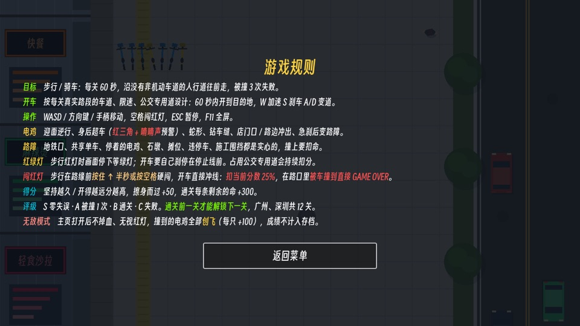 | 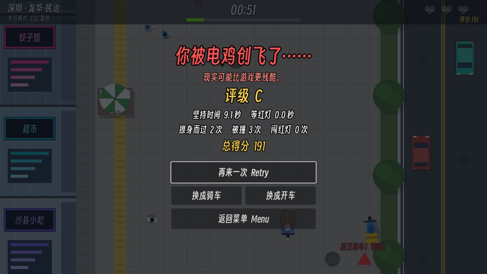 |

## 游戏模式

### 🚶 步行
最灵活，随停随走。在骑楼、玻璃幕墙商业街、城中村的人行道上躲电鸡和行人，遇到路口要等红灯。

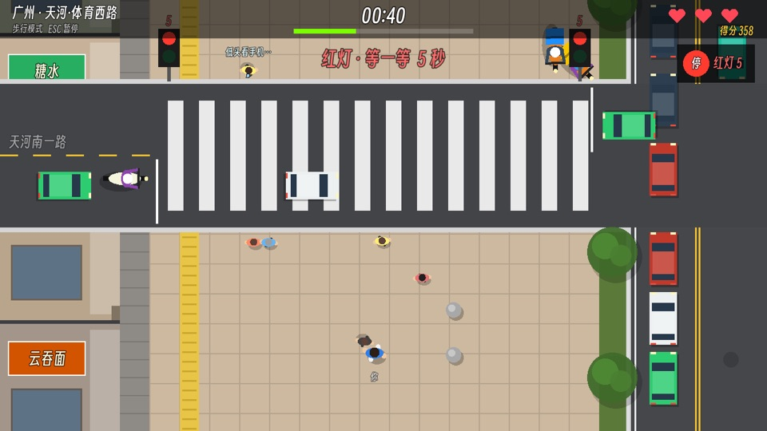

### 🚲 骑车
速度更快，但有惯性、碰撞范围更大，暴雨天更容易刹不住。

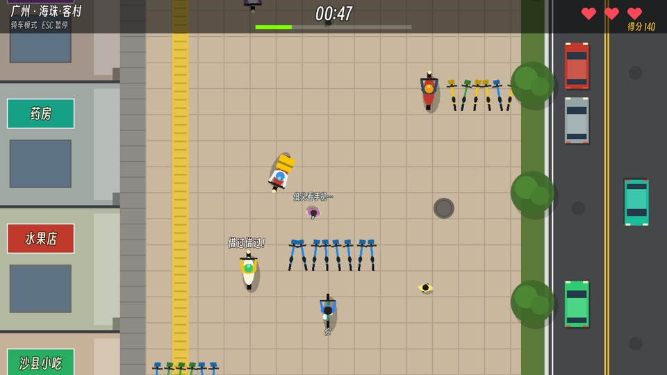

### 🚗 开车
每关换成附近一条**真实可以开车的路段**（步行街、城中村内街开不进去时，改走相邻道路）：车道数、中央隔离、辅道 / 非机动车道、公交专用道、限速、路口名称都按公开资料设计。左下角是车速、限速牌和剩余距离，右上角是前方路口的信号灯。

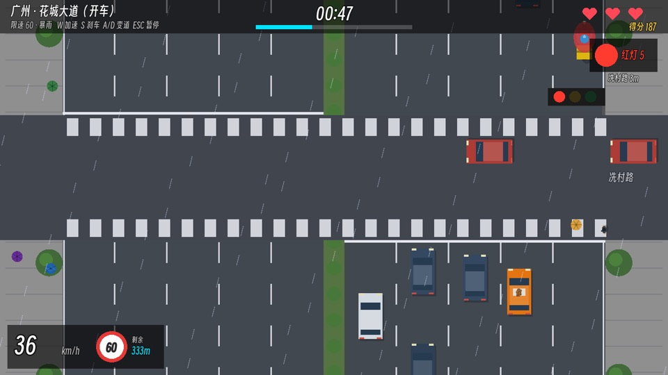

### 💥 无敌模式
主页一键打开：不掉血、无视红灯，撞到的电鸡全部被**创飞**（每只 +100，有连击），12 关全部开放。行人仍然是实心的，不会穿模。无敌模式的成绩不计入存档。  
开车时连汽车、出租车、公交车也能创飞（小车 +200、公交 +300）；行人和施工围挡除外。

| 步行无敌 | 开车无敌 |
|---|---|
| 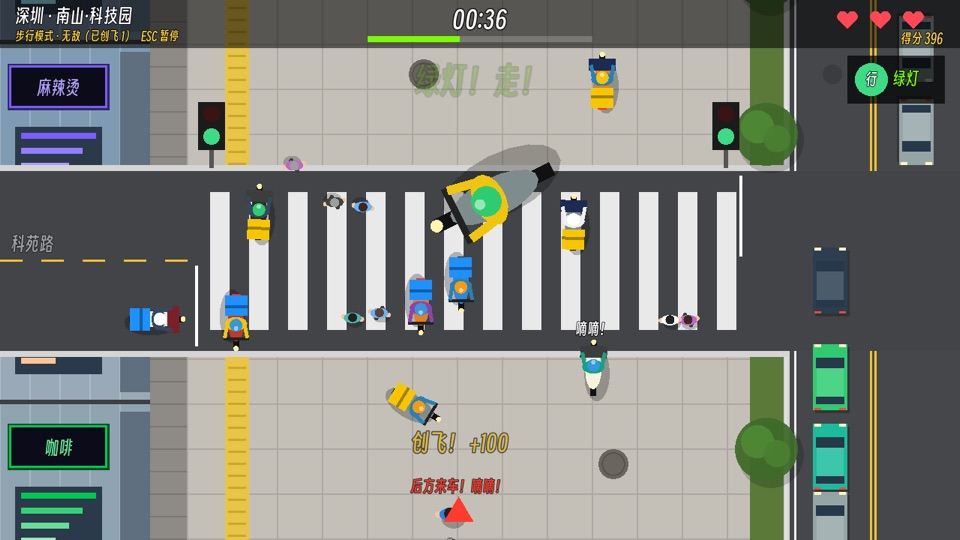 | 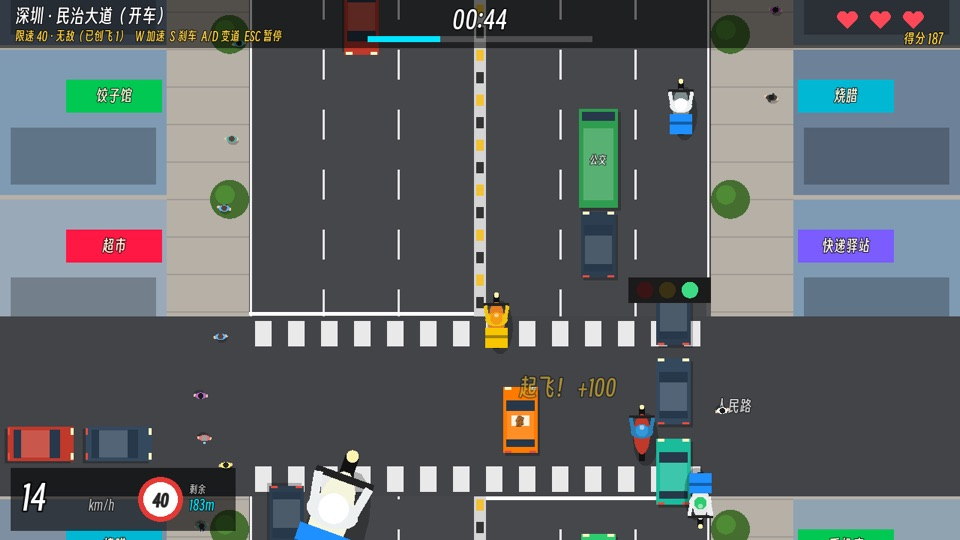 |

## 关卡介绍

广州、深圳交替出现，难度递增。每关的配置都在 `scripts/levels.gd`（开车路段在其中的 `DRIVE`，注释里写了路况资料来源，查不到确切数据的标“估”）。

### 第 1 关 · 广州 · 天河·体育西路
*Guangzhou · Tiyu West Road*

- **步行 / 骑车**：新手关：体育西路地铁站外，迎面逆行的电鸡最多。（骑楼老街 · 2 个路口（天河南一路、天河路））
- **开车 · 体育西路**：双向6车道、车流极大，天河城门口出租车上下客，外卖电鸡贴边逆行。
  - 双向 6 车道 · 中央护栏 · 限速 50 km/h · 目的地 380 米 · 绿灯 8 秒 / 红灯 6 秒 · 路口：天河南一路、天河路
  - 路况依据：体育西路：南北走向，宽 44 米，双向 6 车道，车流量极大（维基百科）

| 步行 / 骑车 | 开车 |
|---|---|
| 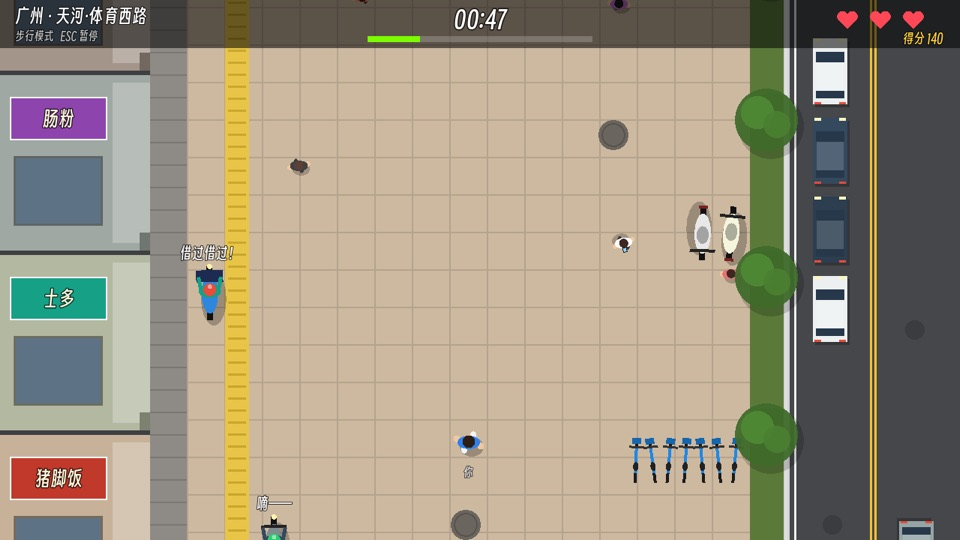 | 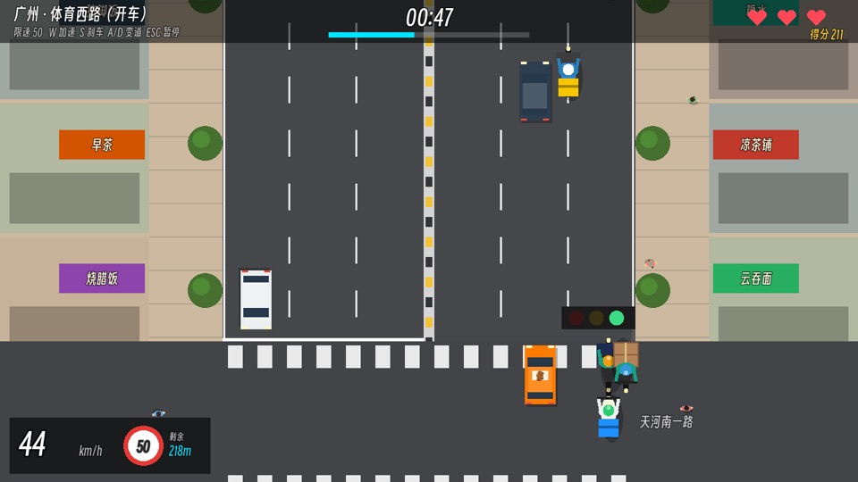 |

### 第 2 关 · 深圳 · 福田·华强北
*Shenzhen · Huaqiang North*

- **步行 / 骑车**：电子市场门口，拉货的电鸡纸箱堆得比人还高。（玻璃幕墙商业街 · 2 个路口（振华路、红荔路））
- **开车 · 振华路（单行）**：华强北路是步行街开不进去，走振华路：由西向东单行，右边有电动车道，可电鸡偏要跑进机动车道。
  - 单行 3 车道 · 右侧有护栏隔开的非机动车道 · 限速 40 km/h · 目的地 320 米 · 绿灯 7 秒 / 红灯 5 秒 · 路口：燕南路、华发北路
  - 路况依据：华强北路红荔路—深南段 2017 年起为步行街，机动车不能进入；振华路由西向东单向通行，2021 年试点机非共板，右侧护栏隔出电动车道（深圳交警通告 / 南方+）

| 步行 / 骑车 | 开车 |
|---|---|
| 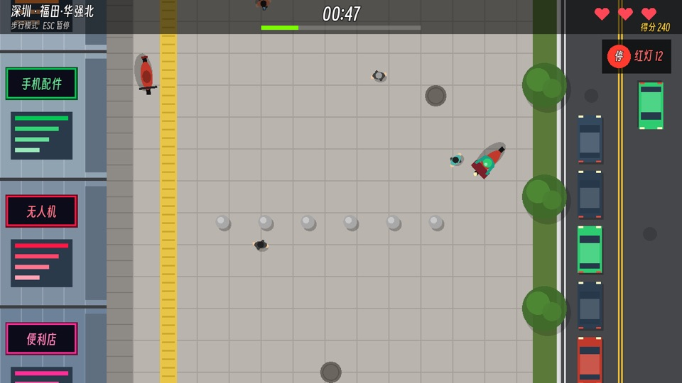 | 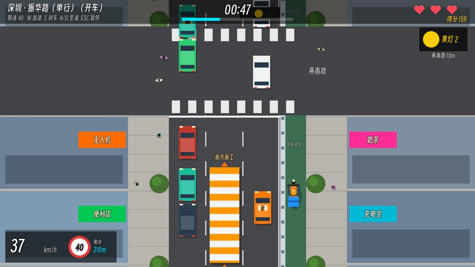 |

### 第 3 关 · 广州 · 越秀·北京路
*Guangzhou · Beijing Road*

- **步行 / 骑车**：骑楼老街人行道窄，糖水档、石墩挡路，要在缝里穿。（骑楼老街 · 人行道窄 · 2 个路口（文明路、中山五路））
- **开车 · 中山五路**：北京路步行街开不进去，走中山五路：双向4车道（估），晚高峰最右是公交专用道，公交车一辆接一辆进站。
  - 双向 4 车道 · 双黄线 · 最右 1 条公交专用道 · 限速 40 km/h · 目的地 240 米 · 绿灯 7 秒 / 红灯 6 秒 · 路口：北京路口、吉祥路口
  - 路况依据：北京路中段是步行街，开车只能走与之相交的中山路（维基百科）；中山五路北京路口—解放路，；公交线路三十多条，高峰时段公交专用道（广州本地宝）；车道数估：双向 4 车道

| 步行 / 骑车 | 开车 |
|---|---|
| 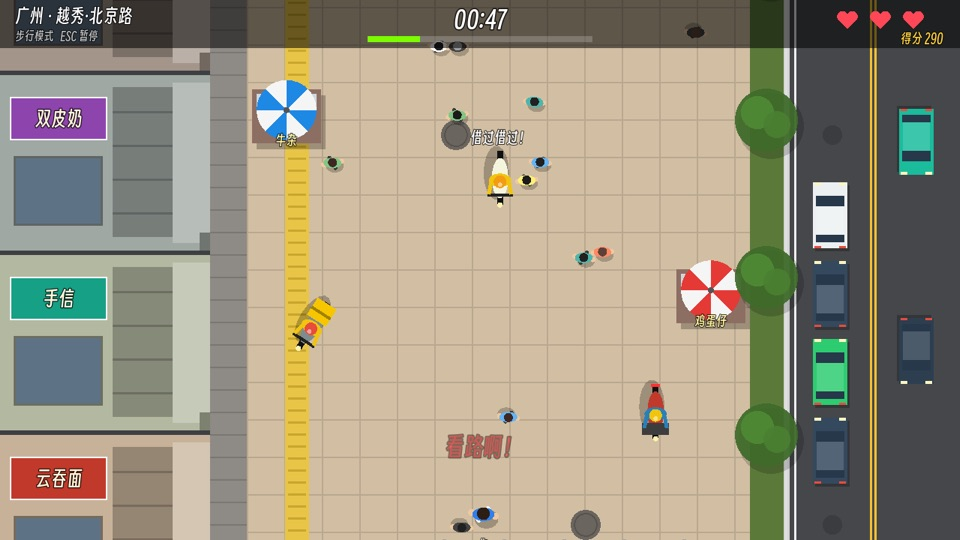 | 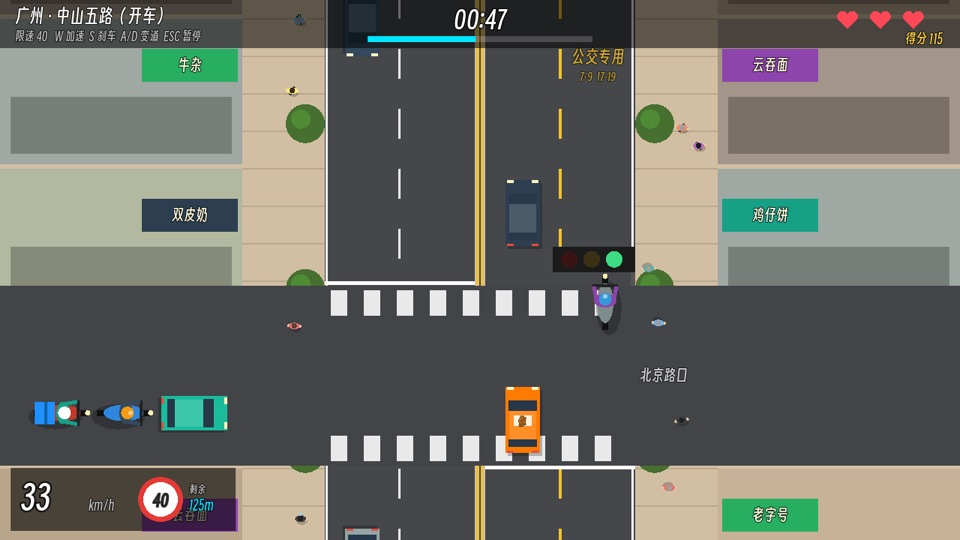 |

### 第 4 关 · 深圳 · 南山·科技园
*Shenzhen · Science Park*

- **步行 / 骑车**：午饭外卖高峰！身后嘀嘀声不断，红灯时电鸡全挤在你身边。（玻璃幕墙商业街 · 3 个路口（科苑路、高新南一道、高新南四道））
- **开车 · 科苑路**：午高峰科苑路排长龙，外卖电鸡在车缝里钻；路口做了绿波，保持约40km/h能一路绿灯。
  - 双向 7 车道 · 中央绿化带 · 限速 50 km/h · 目的地 400 米 · 绿灯 10 秒 / 红灯 5 秒 · **绿波** · 路口：高新中一道、高新南一道、高新南四道
  - 路况依据：科苑路早晚高峰极度拥堵，南行由 3 车道扩为 4 车道（深圳交警 / 知乎）；北行 3 车道（估）；深圳交警通过 AI 优化信号配时、打造绿波路段（深圳交警），这里三个路口按绿波协调

| 步行 / 骑车 | 开车 |
|---|---|
| 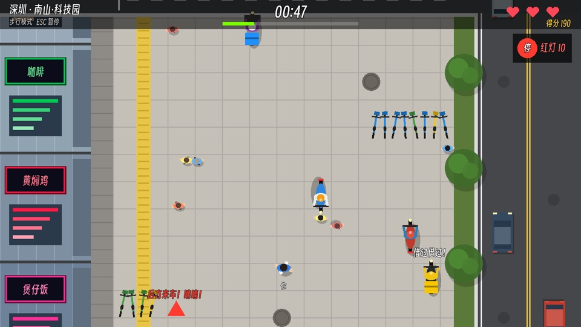 | 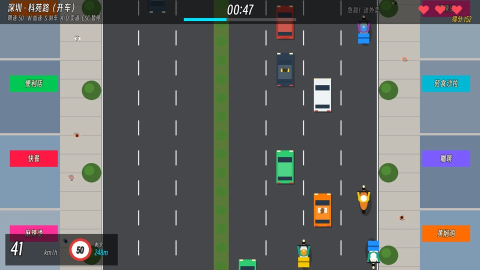 |

### 第 5 关 · 广州 · 海珠·客村
*Guangzhou · Kecun*

- **步行 / 骑车**：换乘站口一个接一个，门口的共享单车堆成山。（骑楼老街 · 2 个路口（新港中路、艺苑路））
- **开车 · 新港中路**：海珠主干道限速60，最右是公交专用道，客村一带公交车密集进站。
  - 双向 6 车道 · 中央绿化带 · 最右 1 条公交专用道 · 限速 60 km/h · 目的地 450 米 · 绿灯 9 秒 / 红灯 6 秒 · 路口：新市头路、艺苑路
  - 路况依据：新港路：海珠区主干道，双向 2—6 车道，限速 60；新港中路设公交专用道（维基百科 / 新浪）

| 步行 / 骑车 | 开车 |
|---|---|
| 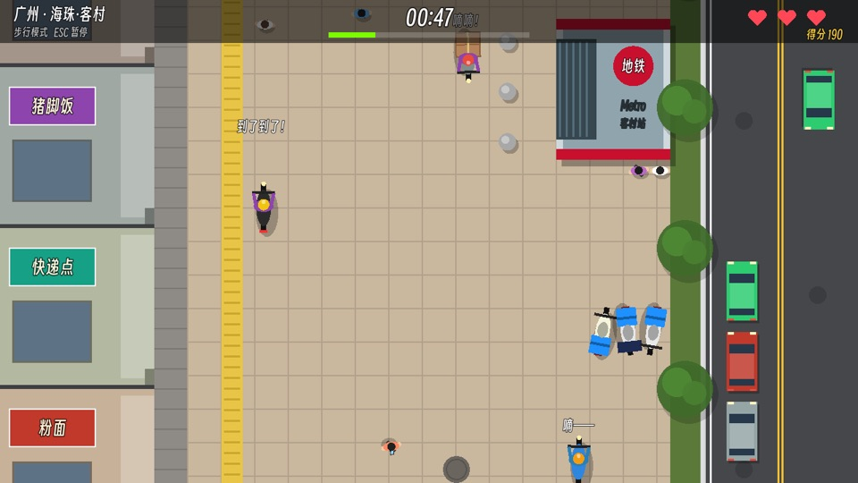 | 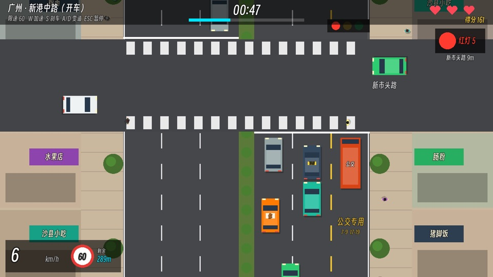 |

### 第 6 关 · 深圳 · 罗湖·东门
*Shenzhen · Dongmen*

- **步行 / 骑车**：老商圈店铺密，电鸡随时从店门口冲出来。（玻璃幕墙商业街 · 2 个路口（解放路、新园路））
- **开车 · 东门中路**：双向7车道，可两边各2条是公交专用道，社会车只能挤在中间；商铺门口电鸡说冲就冲。
  - 双向 7 车道 · 双黄线 · 最右 2 条公交专用道 · 限速 40 km/h · 目的地 300 米 · 绿灯 7 秒 / 红灯 6 秒 · 路口：解放路、晒布路
  - 路况依据：东门中路：原双向 7 车道，南北双向靠右侧各 2 条为公交专用道，社会车辆按单双号进入（深圳本地宝 / 维基百科）

| 步行 / 骑车 | 开车 |
|---|---|
| 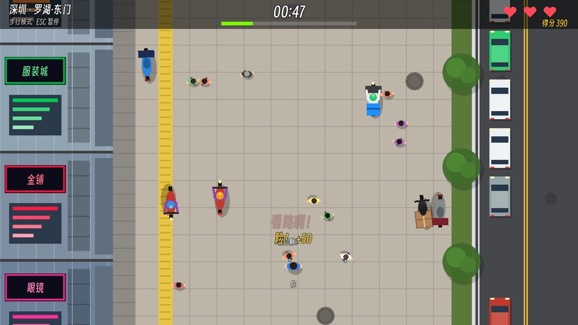 | 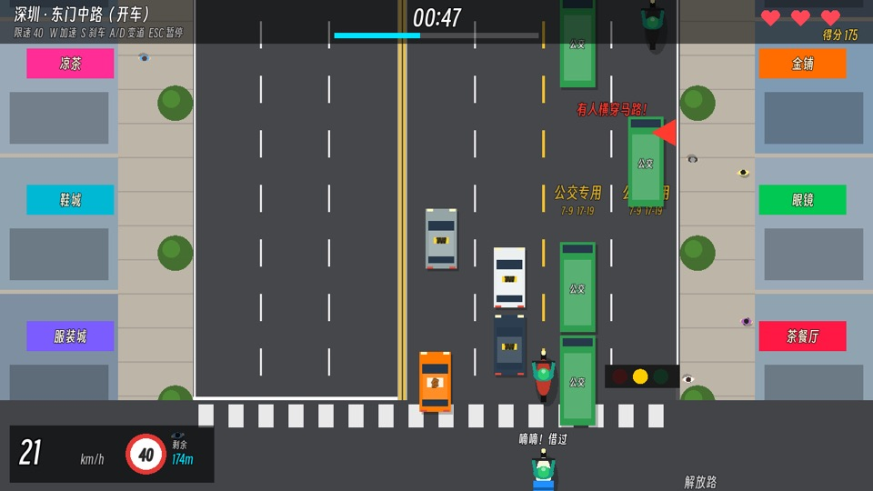 |

### 第 7 关 · 广州 · 珠江新城·花城大道
*Guangzhou · Huacheng Avenue*

- **步行 / 骑车**：暴雨天！地面湿滑刹不住脚，穿雨披的电鸡看不清路。（玻璃幕墙商业街 · 暴雨 · 2 个路口（冼村路、猎德大道））
- **开车 · 花城大道**：双向10车道又宽又快，暴雨天视线差、路面滑，刹车距离明显变长。
  - 双向 10 车道 · 中央绿化带 · 限速 60 km/h · 目的地 520 米 · 绿灯 10 秒 / 红灯 6 秒 · 路口：冼村路、猎德大道
  - 路况依据：花城大道：宽 71 米，双向 10 车道，花城广场段有 CBD 隧道（维基百科）

| 步行 / 骑车 | 开车 |
|---|---|
| 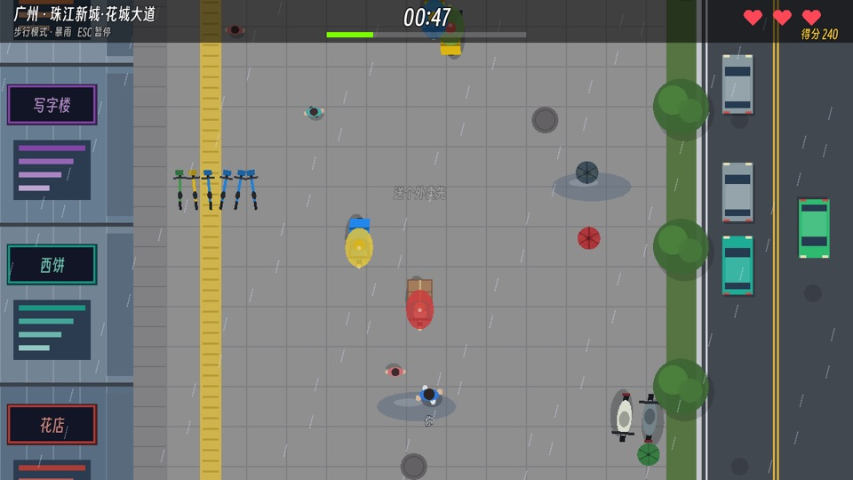 |  |

### 第 8 关 · 深圳 · 福田·车公庙
*Shenzhen · Chegongmiao*

- **步行 / 骑车**：深夜加班回家，路灯昏暗，只能靠车灯判断电鸡在哪。（玻璃幕墙商业街 · 夜间 · 2 个路口（泰然九路、天安路））
- **开车 · 深南大道**：深南大道主路双向8车道、两边辅道，深夜车速快，电鸡从辅道横穿绿化带开口冲进主路。
  - 双向 8 车道 · 中央绿化带 · 两侧有辅道 · 限速 60 km/h · 目的地 480 米 · 绿灯 10 秒 / 红灯 6 秒 · **绿波** · 路口：泰然九路、香梅路
  - 路况依据：深南大道：主路双向 6—8 车道，辅道双向 4 车道，限速 60（深圳交通维基）

| 步行 / 骑车 | 开车 |
|---|---|
| 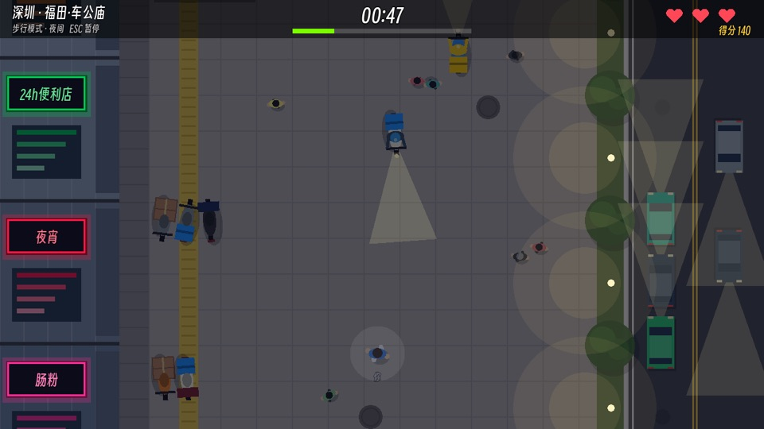 | 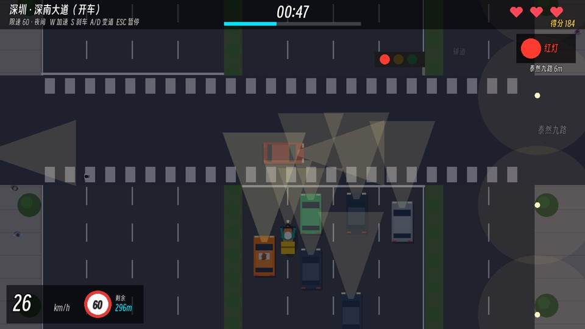 |

### 第 9 关 · 广州 · 天河·石牌村
*Guangzhou · Shipai Village*

- **步行 / 骑车**：城中村握手楼，巷子窄、停满电鸡，蛇形走位的特别多。（城中村握手楼 · 人行道窄 · 1 个路口（石牌东路））
- **开车 · 石牌东路**：贴着石牌村，村巷口随时冲出电鸡，路边违停一辆接一辆。
  - 双向 4 车道 · 双黄线 · 限速 40 km/h · 目的地 230 米 · 绿灯 6 秒 / 红灯 6 秒 · 路口：新陶北街、新陶南街
  - 路况依据：石牌东路：由北往南单行恢复为双向通行；石牌村内近 300 条村路（新浪 / 新华网）；车道数估：双向 4 车道

| 步行 / 骑车 | 开车 |
|---|---|
| 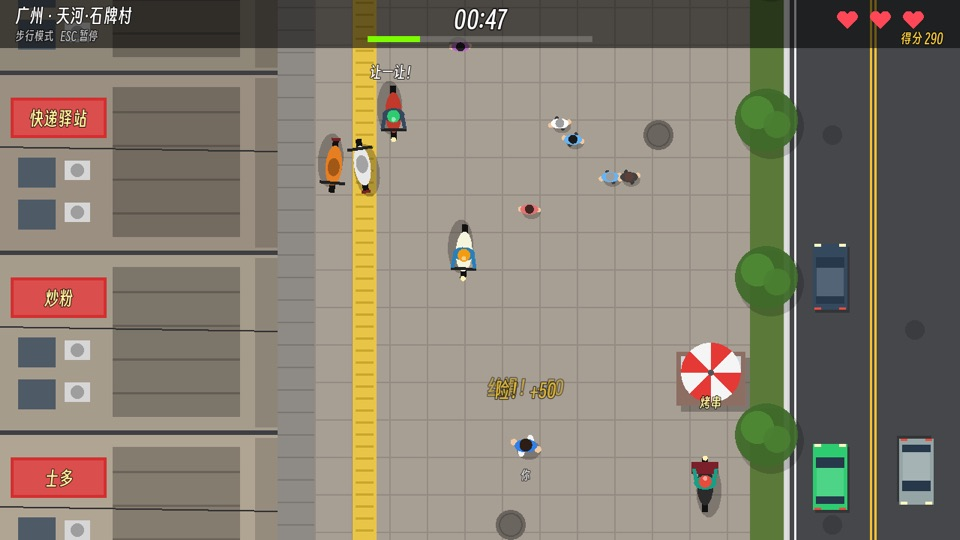 | 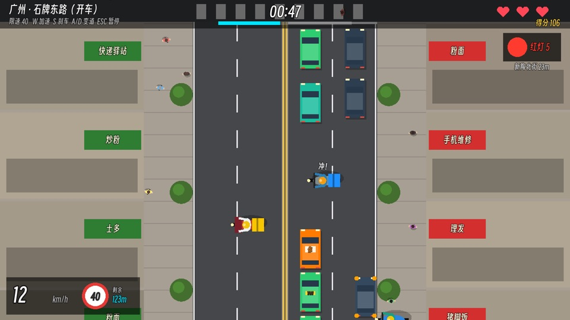 |

### 第 10 关 · 深圳 · 南山·白石洲
*Shenzhen · Baishizhou*

- **步行 / 骑车**：城中村夜市开档，摊位占道，电鸡在灯影里乱窜。（城中村握手楼 · 夜间 · 人行道窄 · 1 个路口（沙河街））
- **开车 · 深南大道辅道**：深南辅道白石洲段，左边绿化带外是主路；公交站一个接一个，城中村电鸡从沙河街口一窝蜂冲出。
  - 单行 2 车道 · 绿化带（外侧是主路） · 最右 1 条公交专用道 · 限速 40 km/h · 目的地 250 米 · 绿灯 8 秒 / 红灯 6 秒 · 路口：沙河街、石洲中路
  - 路况依据：深南大道白石洲段：主路两侧设辅路，沙河街口附近辅路上有多个公交站台（维基百科）

| 步行 / 骑车 | 开车 |
|---|---|
| 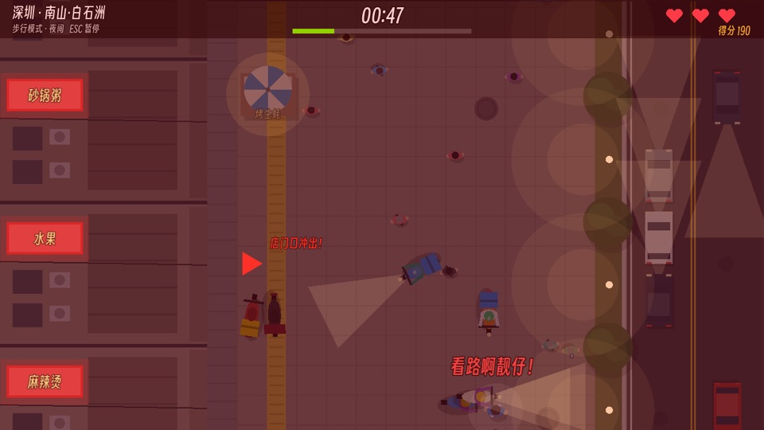 | 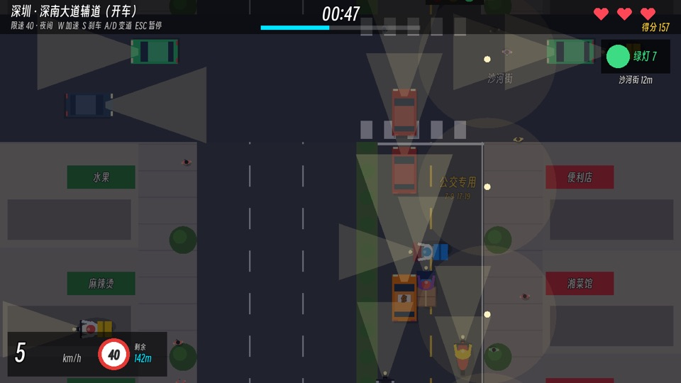 |

### 第 11 关 · 广州 · 白云·新市墟
*Guangzhou · Xinshixu*

- **步行 / 骑车**：暴雨夜，又滑又黑，地铁口外排满了共享单车。（骑楼老街 · 暴雨 · 夜间 · 2 个路口（机场路、新市西街））
- **开车 · 机场路**：头顶是机场高速高架，桥墩挡住视线，暴雨夜路面反光，看不清贴边逆行的电鸡。
  - 双向 6 车道 · 头顶高架、桥墩隔离 · 限速 50 km/h · 目的地 360 米 · 绿灯 8 秒 / 红灯 6 秒 · 路口：齐富路、汇侨南路
  - 路况依据：新市墟站周边为机场路及机场高速高架桥（维基百科）；地面道路车道数估：双向 6 车道

| 步行 / 骑车 | 开车 |
|---|---|
| 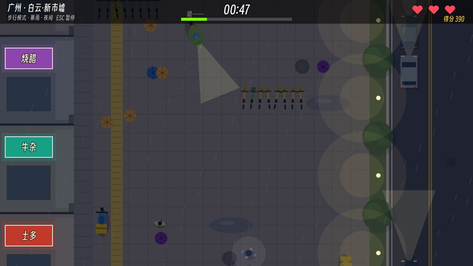 | 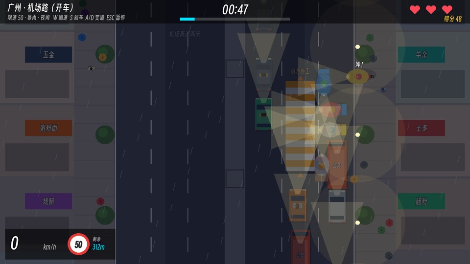 |

### 第 12 关 · 深圳 · 龙华·民治
*Shenzhen · Minzhi*

- **步行 / 骑车**：终极晚高峰：三个红灯，急刹、拉货、外卖、成排电鸡全都来了。（玻璃幕墙商业街 · 3 个路口（民治大道、人民路、梅龙大道））
- **开车 · 民治大道**：双向6车道挤在24米宽的路上，限速40，晚高峰三个红灯，急刹、拉货、钻缝电鸡全都来了。
  - 双向 6 车道 · 中央护栏 · 限速 40 km/h · 目的地 270 米 · 绿灯 7 秒 / 红灯 6 秒 · 路口：人民路、梅龙路、工业路
  - 路况依据：民治大道：龙华区城市主干路，宽 24 米，限速 40，双向 6 车道（维基百科）

| 步行 / 骑车 | 开车 |
|---|---|
| 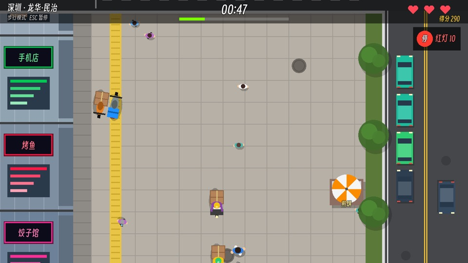 | 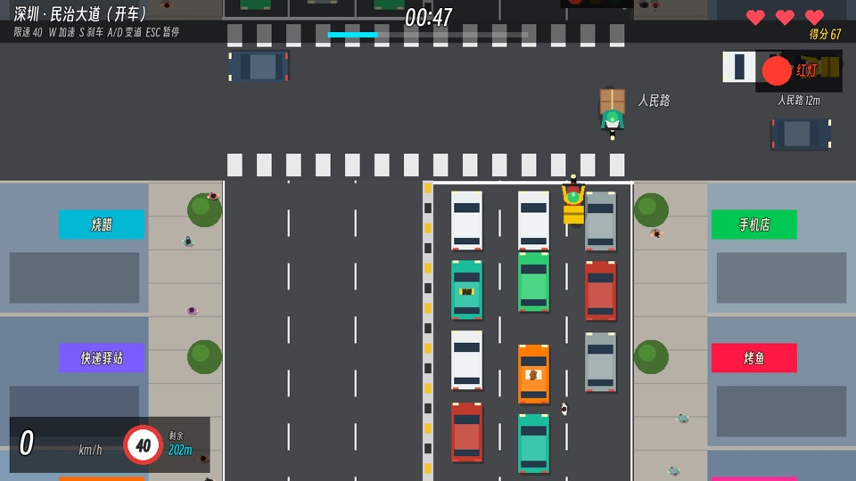 |

## 运行

需要 [Godot 4.7](https://godotengine.org/download)。

```
Godot --path .                                         # 直接玩
Godot -e --path .                                      # 打开编辑器
Godot --path . -- --autostart=drive --level=7 --god    # 跳过菜单直接进关卡（walk/bike/drive，level 0–11），不掉血
Godot --path . -- --unlock-all | --reset-save | --rules | --support | --invincible
```

## 测试
```
Godot --headless --path . --script tests/car_overlap_test.gd   # 步行/骑车：车不重叠、车不压电鸡、路口都出现
Godot --headless --path . --script tests/drive_test.gd         # 开车：自动驾驶跑 12 关，任何参与者互不重叠
Godot --headless --path . --script tests/jaywalk_test.gd       # 闯红灯扣 25%、恢复前进、被车撞 GAME OVER
Godot --headless --path . --script tests/jaywalk_keys_test.gd  # 真实按键：按住 W / 空格 都能闯
Godot --headless --path . --script tests/i18n_test.gd         # 11 种语言：译文生效、每个字符都有字体能显示
Godot --headless --path . --script tests/font_test.gd          # 所有中文字符都能显示（列出得意黑缺、回退系统字体的字）
Godot --headless --path . --script tests/invincible_test.gd    # 无敌模式乱冲：玩家不和任何东西穿模
Godot --headless --path . --script tests/light_test.gd         # 信号灯不会卡在红灯
Godot --headless --path . --script tests/audit_test.gd         # 开车关卡体检：到达率 / 堵车 / 最长红灯 / 借道 / 重叠
```

截图用 `tools/screenshot.gd` 生成（录屏时请保持窗口不被遮挡，或加 `--always-on-top`）：
```
Godot --always-on-top --path . --script tools/screenshot.gd --write-movie /tmp/shot/f.png --fixed-fps 10 --quit-after 200 -- --only=0 --mode=drive
```

## 网页版 / 手机

手机、平板的浏览器里不接键盘手柄也能玩（自动出现触屏操作）。
- 触屏操作：左半屏按下拖动 = 摇杆（开车时左右变道）；开车右下角油门 / 刹车；步行红灯时路缘右侧出现“闯红灯”按钮；顶部 II 暂停。请横屏游玩。
- 导出：`Godot --headless --path . --export-release "Web" build/web/index.html`（单线程，普通静态托管即可，无需特殊响应头）
- 本地 / 局域网试玩：`python3 tools/serve_web.py`，手机连同一 Wi-Fi 打开显示的地址
- 端到端测试（Chrome 模拟横屏触屏手机）：`python3 tools/mobile_web_test.py`；触屏单元测试：`tests/touch_test.gd`
- 网页没有系统字体，日韩阿越等文字使用 `fonts/noto/` 下的 Noto 子集字体（`tools/build_fonts.py` 生成）

## 其他
- 画面、音效全部程序化生成，没有外部美术素材。
- 字体：[得意黑 Smiley Sans](https://github.com/atelier-anchor/smiley-sans)（SIL OFL 1.1，协议见 `fonts/SmileySans-OFL.txt`），缺字时回退到系统中文字体。
- 多语言：游戏支持 11 种语言（简体中文、English、日本語、한국어、Français、Español、Deutsch、العربية、Tiếng Việt、Português、Italiano），主菜单右上角切换，首次启动跟随系统语言。译文在 `locale/<语言>.po`，翻译规则和术语表见 `locale/TRANSLATION_NOTES.md`；新增文字后运行 `python3 tools/extract_strings.py` 更新 `messages.pot`，再用 `python3 tools/check_po.py locale/*.po` 校验。
- 存档位置：`user://save.cfg`（解锁进度、每关最佳成绩、出行方式、是否看过规则、无敌模式开关）。
- 主页有“支持作者”页面（点击地址即可复制），`scripts/main.gd` 里把 `SUPPORT_ENABLED` 改成 `false` 可隐藏。
